|  | Praktikum Pemrograman Berbasis Objek |
| --- | --- |
| NIM | 254107020065 |
| Nama | Mayla Ayu Kirana Nathaniela |
| Kelas | TI 2G |
| Repository | [https://github.com/maylakirana2605-ui/PraktikumPBO](https://github.com/maylakirana2605-ui/PraktikumPBO) |

# Jobsheet Praktikum 7: Overloading dan Overriding

## Percobaan 1: Overloading Method (Perkalian)

Solusi diimplementasikan pada file:

* [Perkalian.java](../percobaan1/Perkalian.java)
* [MainPercobaan1.java](../percobaan1/MainPercobaan1.java)

output:

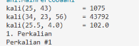

### Ekaperimen

1. Eksperimen 1

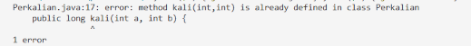

2. Eksperimen 2

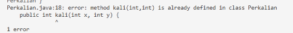

3. Eksperimen 3

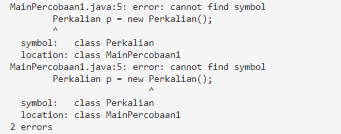

## Pertanyaan Percobaan 1

### 1. Sebutkan method hasil overloading pada Perkalian dan pembeda tiap pasangannya (jumlah, tipe, atau urutan parameter).

Method hasil overloading pada class Perkalian:

* kali(int a, int b) dan kali(int a, int b, int c): Pembedanya adalah jumlah parameter (2 parameter int vs 3 parameter int).
* kali(int a, int b) dan kali(double a, double b): Pembedanya adalah tipe parameter (tipe int vs tipe double).
* tampilkan(int nomor, String label) dan tampilkan(String label, int nomor): Pembedanya adalah urutan tipe parameter (int lalu String vs String lalu int).

### 2. Pada p.kali(25.5, 4.0), versi kali() mana yang dipanggil? Mengapa bukan versi int?

Versi kali() yang dipanggil adalah kali(double a, double b). Versi int tidak dipanggil karena argumen yang dimasukkan (25.5 dan 4.0) bertipe desimal (double), sehingga compiler mencari signature method yang paling cocok dengan tipe data argumen tersebut.

### 3. Mengapa tampilkan(int, String) dan tampilkan(String, int) sah sebagai overloading, sedangkan dua method yang hanya beda tipe kembalian atau nama parameter tidak?

Method tampilkan(int, String) dan tampilkan(String, int) sah sebagai overloading karena urutan tipe parameternya berbeda, sehingga compiler dapat membedakannya saat pemanggilan berdasarkan urutan argumen. Sebaliknya, perbedaan tipe kembalian atau nama variabel parameter tidak termasuk dalam method signature yang diperiksa compiler saat pemanggilan, sehingga akan memicu error method sudah didefinisikan (duplicate method).

### 4. Pada eksperimen ketiga, mengapa kali(5, 2.5) menghasilkan 12.5 dan bukan error?

Hal ini tidak menyebabkan error karena argumen pertama (5) yang bertipe int secara otomatis dikonversi oleh compiler menjadi double (proses widening) agar cocok dengan method kali(double a, double b).

## Percobaan 2: Pemilihan Overload oleh Compiler (Resolusi)

Solusi diimplementasikan pada file:

* [Resolusi.java](../percobaan2/Resolusi.java)
* [MainPercobaan2.java](../percobaan2/MainPercobaan2.java)

output:

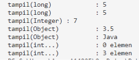

### eksperimen:

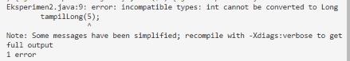

## Pertanyaan Percobaan 2

### 1. Mengapa tampil(5) memilih tampil(long) dan bukan tampil(Integer), padahal 5 dapat di-boxing? Sebutkan fase yang menentukan.

Hal ini terjadi karena compiler Java mendahulukan proses widening (pelebaran tipe primitif dari int ke long) pada fase pertama pemilihan overload sebelum mencoba proses boxing (pengubahan int menjadi objek Integer) pada fase kedua. Fase yang menentukan adalah fase pertama (identitas dan widening).

### 2. Jelaskan perpindahan overload pada tiap baris tabel Langkah 3.

* Ketika semua overload aktif, tampil(5) memanggil tampil(long) karena widening dari int ke long berada di prioritas teratas (fase 1).
* Ketika tampil(long) dikomentari, tampil(5) beralih memanggil tampil(Integer) melalui proses boxing (fase 2).
* Ketika tampil(long) dan tampil(Integer) dikomentari, tampil(5) beralih memanggil tampil(Object) karena nilai int di-boxing menjadi Integer lalu di-widening menjadi Object (fase 2).
* Ketika tampil(long), tampil(Integer), dan tampil(Object) dikomentari, tampil(5) beralih memanggil tampil(int...) melalui fitur varargs (fase 3).

### 3. Mengapa tampilLong(5) gagal, sedangkan tampil(5) dapat berakhir pada tampil(Object) bila overload lain dikomentari?

Pemanggilan tampilLong(5) gagal karena Java tidak mengizinkan kombinasi proses widening lalu boxing secara langsung dari tipe primitif int ke wrapper Long (int ke long lalu ke Long). Sebaliknya, tampil(5) berhasil berakhir pada tampil(Object) karena Java mengizinkan proses boxing terlebih dahulu dari int ke Integer, kemudian di-widening dari Integer menjadi Object.

### 4. Tantangan. Tanpa menjalankan, prediksi output Resolusi.tampil((short) 3) dan Resolusi.tampil('A'), lalu buktikan.

Prediksi output untuk Resolusi.tampil((short) 3) adalah tampil(long): 3 karena tipe short di-widening menjadi long. Prediksi output untuk Resolusi.tampil('A') adalah tampil(long): 65 karena tipe char di-widening menjadi long berdasarkan nilai ASCII karakter tersebut (65).

## Percobaan 3: Overloading Konstruktor (Kucing)

Solusi diimplementasikan pada file:

* [Kucing.java](../percobaan3/Kucing.java)
* [MainPercobaan3.java](../percobaan3/MainPercobaan3.java)

output:

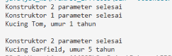

### Eksperimen

## Pertanyaan Percobaan 3

### 1. Mengapa Konstruktor 2 parameter selesai tercetak lebih dulu daripada Konstruktor 1 parameter selesai pada new Kucing(Tom)?

Hal ini terjadi karena pada baris pertama di dalam konstruktor 1 parameter terdapat pemanggilan this(nama, 1) yang mengeksekusi konstruktor 2 parameter terlebih dahulu. Setelah seluruh perintah di dalam konstruktor 2 parameter selesai dijalankan, eksekusi program baru kembali untuk menyelesaikan sisa perintah pada konstruktor 1 parameter.

### 2. Apa keuntungan this(nama, 1) dibandingkan menyalin isi konstruktor kedua ke konstruktor pertama?

Keuntungannya adalah menghindari duplikasi kode program (code duplication) dan mempermudah pemeliharaan kode (code maintenance). Logika pengisian nilai atribut pusat cukup diatur di satu konstruktor, sehingga jika terjadi perubahan logika di masa mendatang, perubahan hanya perlu dilakukan pada satu tempat saja.

### 3. Tambahkan public Kucing() yang memanggil this(Tanpa Nama) dan mencetak Konstruktor 0 parameter selesai. Tuliskan output new Kucing() serta urutan ketiga konstruktor dijalankan.

Output dari new Kucing() adalah:
Konstruktor 2 parameter selesai
Konstruktor 1 parameter selesai
Konstruktor 0 parameter selesai

Urutan ketiga konstruktor yang dijalankan adalah:

1. Konstruktor 0 parameter dipanggil pertama kali, lalu meneruskan panggilan ke this(Tanpa Nama).
2. Konstruktor 1 parameter menerima panggilan, lalu meneruskan ke this(nama, 1).
3. Konstruktor 2 parameter dieksekusi hingga selesai mencetak pesannya.
4. Eksekusi kembali menyelesaikan konstruktor 1 parameter.
5. Eksekusi kembali menyelesaikan konstruktor 0 parameter.

## Percobaan 4: Dasar Overriding (Ikan dan Piranha)

Solusi diimplementasikan pada file:

* [Ikan.java](percobaan4/Ikan.java)
* [Piranha.java](../percobaan4/Piranha.java)
* [MainPercobaan4.java](../percobaan4/MainPercobaan4.java)

output:

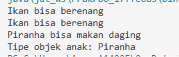

## Pertanyaan Percobaan 4

1. ### Bandingkan a.swim() dan c.swim(). Apa peran super.swim(), dan apa yang tercetak bila baris itu dihapus?

Method a.swim() memanggil method swim() milik class Ikan yang mencetak Ikan bisa berenang. Method c.swim() memanggil method swim() milik class Piranha yang meng-override versi superclass-nya. Peran super.swim() adalah untuk memanggil dan menjalankan terlebih dahulu method swim() milik superclass (Ikan). Jika baris super.swim() dihapus, maka teks Ikan bisa berenang tidak akan tercetak saat c.swim() dipanggil, dan hanya mencetak Piranha bisa makan daging.

### 2. Apa manfaat covariant return pada beranak()? Apakah Piranha anak = a.beranak(); valid? Mengapa?

Manfaat covariant return adalah memungkinkan method overriding pada subclass mengembalikan tipe data spesifik milik subclass itu sendiri (Piranha) sehingga pemanggil method tidak perlu melakukan type casting manual. Sintaks Piranha anak = a.beranak(); tidak valid dan memicu error kompilasi karena method a.beranak() milik objek Ikan mengembalikan tipe data bertipe Ikan, yang mana tipe superclass tidak dapat langsung disimpan ke dalam variabel bertipe subclass (Piranha) tanpa casting eksplisit.

### 3. Untuk tiap baris tabel Langkah 4, sebutkan aturan overriding yang dilanggar.

* Baris 1 (Menghapus public pada swim() di Piranha): Melanggar aturan access modifier, di mana access modifier method overriding tidak boleh lebih ketat daripada method overridden milik superclass (mencoba menurunkan akses dari public menjadi default).
* Baris 2 (Menambahkan final pada swim() di Ikan): Melanggar aturan pewarisan method, di mana method yang dideklarasikan dengan kata kunci final tidak dapat di-override oleh subclass.
* Baris 3 (Mengubah swim() di Piranha menjadi swim(int jarak) dengan @Override): Melanggar aturan method signature, di mana daftar parameter method overriding harus sama persis dengan method overridden pada superclass.
* Baris 4 (Menambahkan throws Exception pada swim() di Piranha): Melanggar aturan exception, di mana method overriding tidak boleh melempar checked exception baru yang tidak dideklarasikan oleh method pada superclass.

### 4. Pada baris ketiga tabel, apa yang terjadi bila @Override dihapus? Apakah swim(int) overriding atau overloading?

Jika anotasi @Override dihapus, kode akan berhasil dikompilasi tanpa error. Method swim(int) tersebut bertindak sebagai method overloading baru pada class Piranha, bukan method overriding, karena memiliki nama yang sama tetapi daftar parameternya berbeda dengan swim() pada superclass.

### 5. Tantangan. Jika swim() di Ikan dibuat private dan Piranha memiliki @Override public void swim(), apa yang terjadi? Mengapa?

Program akan mengalami error kompilasi pada anotasi @Override di class Piranha. Hal ini terjadi karena method private pada superclass disembunyikan sepenuhnya dari subclass sehingga tidak dianggap diwariskan, akibatnya method swim() pada Piranha dianggap mencoba meng-override method yang tidak pernah ada bagi subclass tersebut.

## Percobaan 5: Overloading dan Overriding Bersama (Karyawan, Staff, Manager)

Solusi diimplementasikan pada file:

* [Karyawan.java](percobaan5/Karyawan.java)
* [Staff.java](../percobaan5/Staff.java)
* [Manager.java](../percobaan5/Manager.java)
* [MainPercobaan5.java](../percobaan5/MainPercobaan5.java)

output:

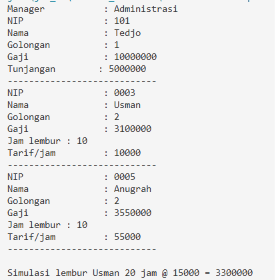

## Pertanyaan Percobaan 5

1. ### Tunjuk method yang termasuk overloading dan yang termasuk overriding pada ketiga class (sebutkan class dan signature-nya), dan jelaskan pembeda masing-masing.

* Class Staff:
* Method getGaji(int jamLembur, double tarifLembur) merupakan overloading dari getGaji() milik Karyawan karena menambahkan parameter baru (int, double).
* Method getGaji() tanpa parameter merupakan overriding dari getGaji() milik Karyawan karena memiliki signature yang sama persis.
* Method lihatInfo() merupakan overriding dari lihatInfo() milik Karyawan.

* Class Manager:
* Method getGaji() merupakan overriding dari getGaji() milik Karyawan.
* Method lihatInfo() merupakan overriding dari lihatInfo() milik Karyawan.

Pembeda utamanya adalah: Overloading terjadi ketika nama method sama tetapi daftar parameternya berbeda, sedangkan Overriding terjadi ketika nama method dan daftar parameternya sama persis dengan yang ada pada superclass.

### 2. Mengapa getGaji(int, double) memakai super.getGaji(), sedangkan getGaji() pada Staff memanggil getGaji(jamLembur, tarifLembur)? Apa yang terjadi bila isi getGaji(int, double) diganti return getGaji() + jamLembur * tarifLembur;?

Method getGaji(int, double) menggunakan super.getGaji() untuk mengambil nilai gaji pokok yang dihitung oleh superclass Karyawan. Method getGaji() tanpa parameter pada Staff memanggil getGaji(jamLembur, tarifLembur) untuk meneruskan nilai atribut internalnya ke method hitung kalkulasi lembur. Jika isi getGaji(int, double) diganti menjadi return getGaji() + jamLembur * tarifLembur;, akan terjadi rekursi tak terbatas (infinite recursion / StackOverflowError) karena getGaji(int, double) dan getGaji() akan saling memanggil satu sama lain tanpa henti.

### 3. Apa akibatnya pada gaji Staff bila getGaji() di Staff ditulis return jamLembur * tarifLembur;? Apakah gaji Manager ikut berubah?

Akibatnya, perhitungan gaji Staff hanya menghitung total uang lembur saja tanpa menjumlahkan gaji pokok dari superclass Karyawan. Gaji Manager tidak ikut berubah karena class Manager meng-override method getGaji() miliknya sendiri dengan memanggil super.getGaji() + tunjangan yang langsung terhubung ke class Karyawan, bukan ke class Staff.

### 4. Apa hubungan Manager dengan Staff (is-a atau has-a)? Tunjuk atributnya dan bandingkan dengan hubungan Manager dengan Karyawan.

Hubungan Manager dengan Staff adalah hubungan has-a (agregasi), ditunjukkan oleh atribut bawahan bertipe array Staff[] (private Staff[] bawahan;). Sementara itu, hubungan Manager dengan Karyawan adalah hubungan is-a (pewarisan/inheritance), yang ditunjukkan oleh sintaks public class Manager extends Karyawan.

## Tugas 1: Overloading pada class Segitiga

Solusi diimplementasikan pada file:

* [Segitiga.java](tugas1/Segitiga.java)
* [MainTugas1.java](../tugas1/MainTugas1.java)

output:

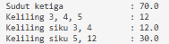

## Pertanyaan Analisis Tugas 1

### (a) keliling(3, 4, 5) dan keliling(3, 4) bertipe kembalian berbeda. Apakah itu yang membuatnya sah sebagai overloading? Apa pembeda sebenarnya?

Perbedaan tipe kembalian bukan hal yang membuatnya sah sebagai overloading, karena tipe kembalian tidak pernah diperiksa oleh compiler saat membedakan method overloading. Pembeda sebenarnya adalah jumlah parameternya, di mana keliling(3, 4, 5) menerima 3 parameter bertipe int sedangkan keliling(3, 4) menerima 2 parameter bertipe int.

### (b) Apa yang terjadi bila t.keliling(3, 4.0) dipanggil? Tuliskan pesan error dan alasannya.

Pemanggilan t.keliling(3, 4.0) akan menghasilkan error kompilasi dengan pesan no suitable method found for keliling(int,double). Hal ini terjadi karena class Segitiga hanya menyediakan method keliling dengan kombinasi parameter (int, int, int) dan (int, int), sehingga tidak ada signature method keliling yang menerima parameter gabungan int dan double.

## Tugas 2: Overriding pada Manusia, Dosen, dan Mahasiswa

Solusi diimplementasikan pada file:

* [Manusia.java](../tugas2/Manusia.java)
* [Dosen.java](../tugas2/Dosen.java)
* [Mahasiswa.java](../tugas2/Mahasiswa.java)
* [MainTugas2.java](tugas2/MainTugas2.java)

output:

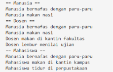

## Pertanyaan Analisis Tugas 2

### (a) Mengapa bernafas() pada objek Mahasiswa mencetak teks milik Manusia, sedangkan makan() tidak?

Method bernafas() pada objek Mahasiswa mencetak teks milik Manusia karena class Mahasiswa tidak meng-override method bernafas(), sehingga objek Mahasiswa secara otomatis menjalankan method bernafas() asli yang diwarisi dari superclass Manusia. Sementara itu, method makan() pada class Mahasiswa telah di-override secara penuh, sehingga saat dipanggil yang dieksekusi adalah method makan() versi Mahasiswa.

### (b) Bandingkan hasil makan() pada Dosen dan Mahasiswa, lalu jelaskan peran super.makan().

Hasil pemanggilan makan() pada Dosen mencetak dua baris teks (makanan Manusia dan lokasi makan Dosen), sedangkan pada Mahasiswa hanya mencetak satu baris teks (lokasi makan Mahasiswa). Peran super.makan() di dalam Dosen.makan() adalah untuk memanggil terlebih dahulu perilaku dasar method makan() milik superclass Manusia sebelum mengeksekusi perintah tambahan spesifik milik class Dosen.

## Tugas 3: Jawab Singkat

### 1. Perbandingan Overloading dan Overriding

| Aspek | Overloading | Overriding |
| --- | --- | --- |
| Lokasi terjadi | Terjadi dalam satu class yang sama atau antara superclass dan subclass. | Terjadi antara dua class yang memiliki hubungan pewarisan (superclass dan subclass). |
| Signature (parameter) | Harus berbeda (dalam jumlah, tipe, atau urutan parameter). | Harus sama persis (jumlah, tipe, dan urutan parameter). |
| Tipe kembalian | Boleh sama maupun berbeda. | Harus sama, atau berupa subclass-nya (covariant return). |
| Access modifier | Boleh sama maupun berbeda. | Harus sama atau memberikan akses yang lebih luas dari superclass. |
| Peran @Override | Tidak dapat digunakan (akan memicu error jika diletakkan pada overloading). | Digunakan sebagai penanda serta validasi kompilasi bahwa method menimpa superclass. |

### 2. Kapan memilih Overloading dan Overriding beserta contohnya:

Overloading dipilih ketika ingin membuat beberapa variasi method dengan nama yang sama untuk memproses tipe atau jumlah data masukan yang berbeda dengan fungsi yang sejenis. Contoh: Method kali() pada class Perkalian yang menerima parameter int maupun double.

Overriding dipilih ketika subclass perlu mengganti atau memodifikasi secara spesifik perilaku method yang diwariskan dari superclass-nya. Contoh: Method makan() pada class Dosen dan Mahasiswa yang mengubah perilaku method makan() dari class Manusia.

### 3. Alasan method static, private, dan final tidak dapat di-override:

Method static tidak dapat di-override karena terikat pada class secara kompilasi (static binding) dan bukan terikat pada instans objek saat runtime. Method private tidak dapat di-override karena bersifat tertutup dan tidak diwariskan sama sekali ke subclass. Method final tidak dapat di-override karena kata kunci final secara eksplisit melarang subclass untuk mengubah atau menimpa implementasi method tersebut.